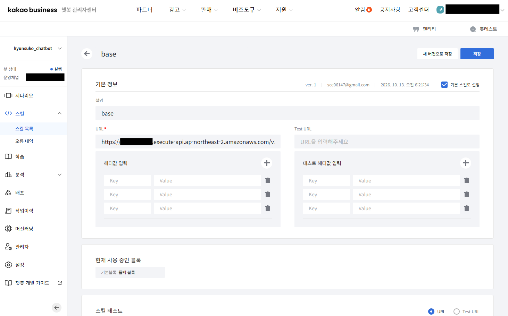
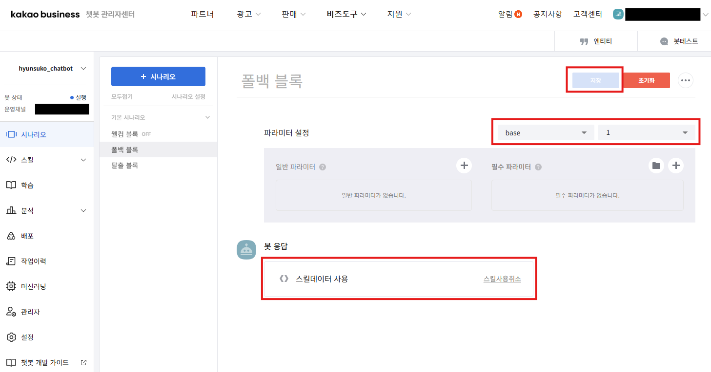
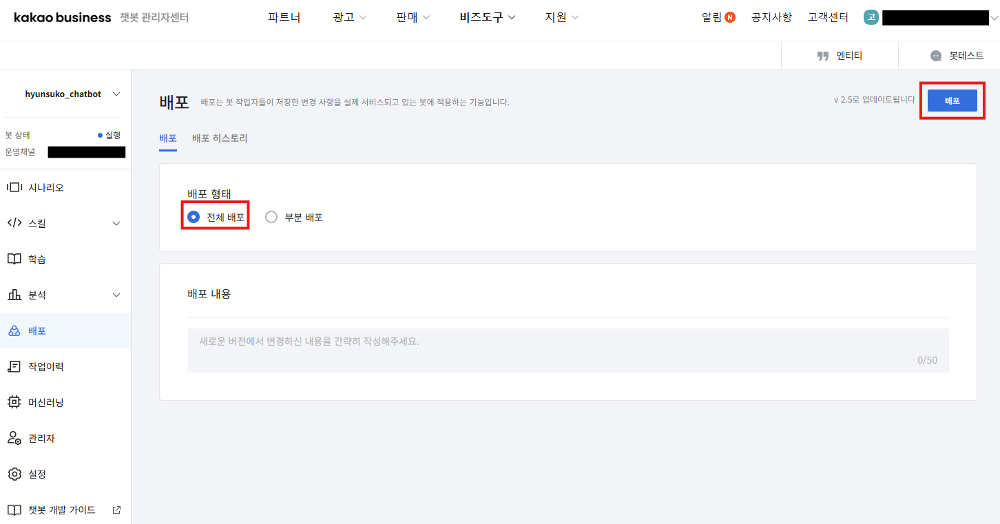

# Bedrock Lambda Kakao Chatbot

1. [카카오 비즈니스](https://business.kakao.com)에서 새로운 **카카오톡 채널** 생성 후, [챗봇 관리자 센터](https://chatbot.kakao.com) 이동. **설정**에서 생성한 카카오톡 채널 연결

2. **스킬** > **스킬 목록**에서 새로운 스킬 생성. 테라폼 구성을 통해 API Gateway 또는 Lambda 함수 URL 생성 후, 스킬 URL에 입력. 이후 챗봇 스킬 저장

```bash
# terraform apply -auto-approve
api_key_value_command = "..."
callback_function = "..."
callback_function_role = "..."
callback_log_command = "aws logs tail ..."
chatbot_log_command = "aws logs tail ..."
images_list_command = "aws s3 ls ..."
kakao_chatbot_function = "..."
kakao_chatbot_function_role = "..."
layer_build_log_command = "aws logs tail ..."
layer_packages = [...]
skill_test_command = "..."
skill_url = "https://xxx.execute-api.xxx.amazonaws.com/v1/kakao" # skill_url 값을 챗봇 관리자 센터 > 스킬 URL에 입력
text_to_image_s3_bucket = "..."
```

  

3. **시나리오** > **폴백 블록**에서 **파라미터 설정**을 생성한 스킬로 선택. **봇 응답**을 **스킬 데이터 사용**으로 선택. 이후 챗봇 시나리오 저장

  

4. **배포**에서 **전체 배포** > **배포** 선택. 이후 카카오톡 앱에서 생성한 채널 입장 후, 카카오 챗봇 동작 확인  

  