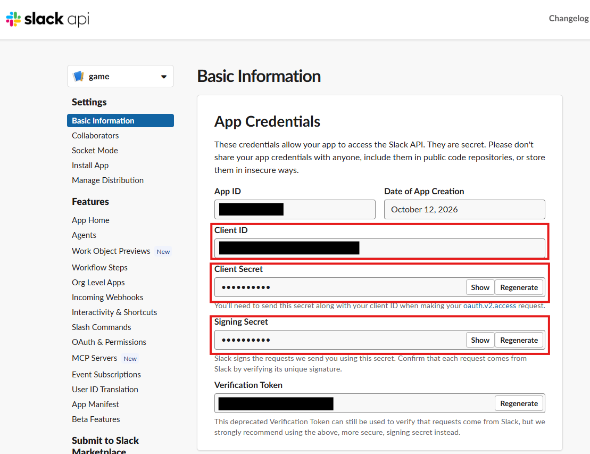
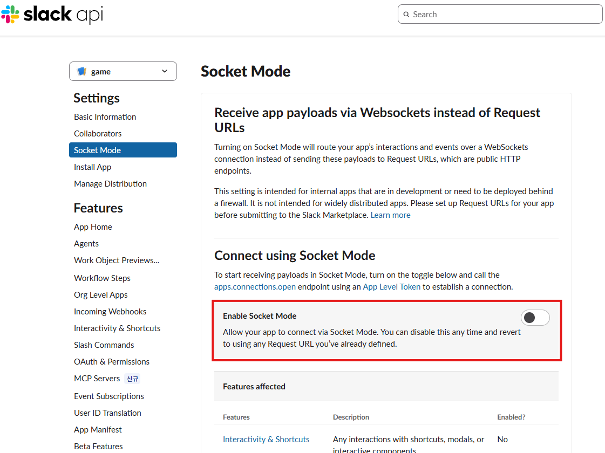
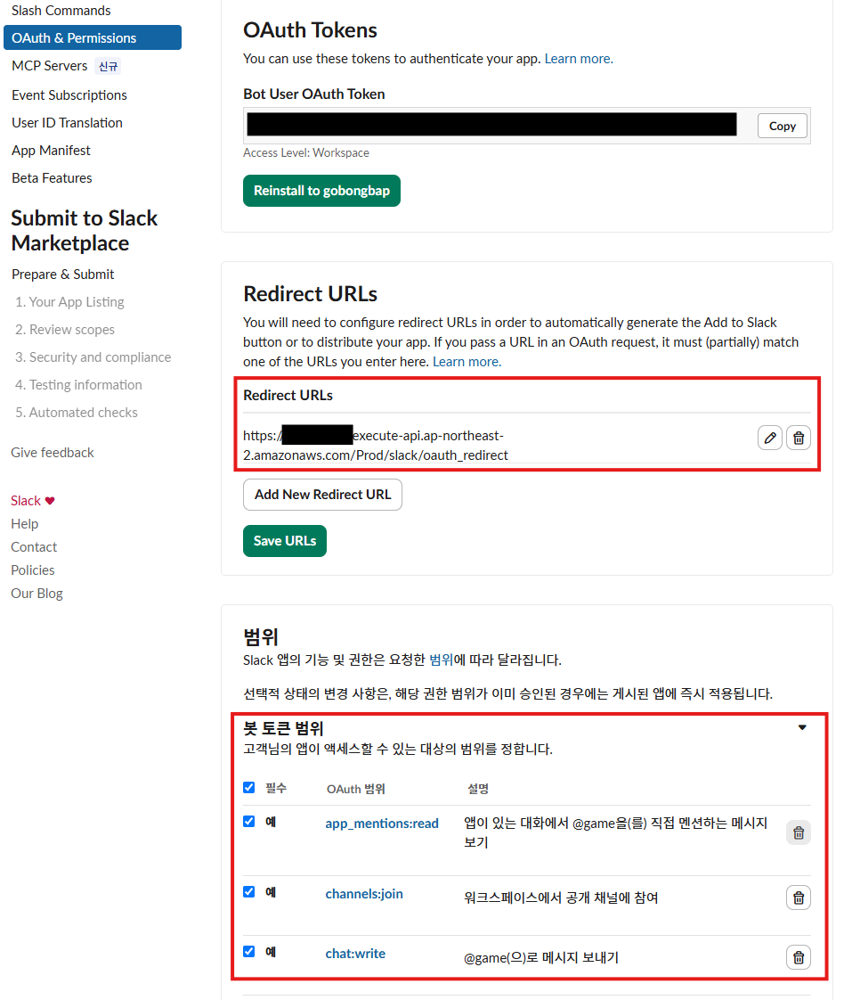
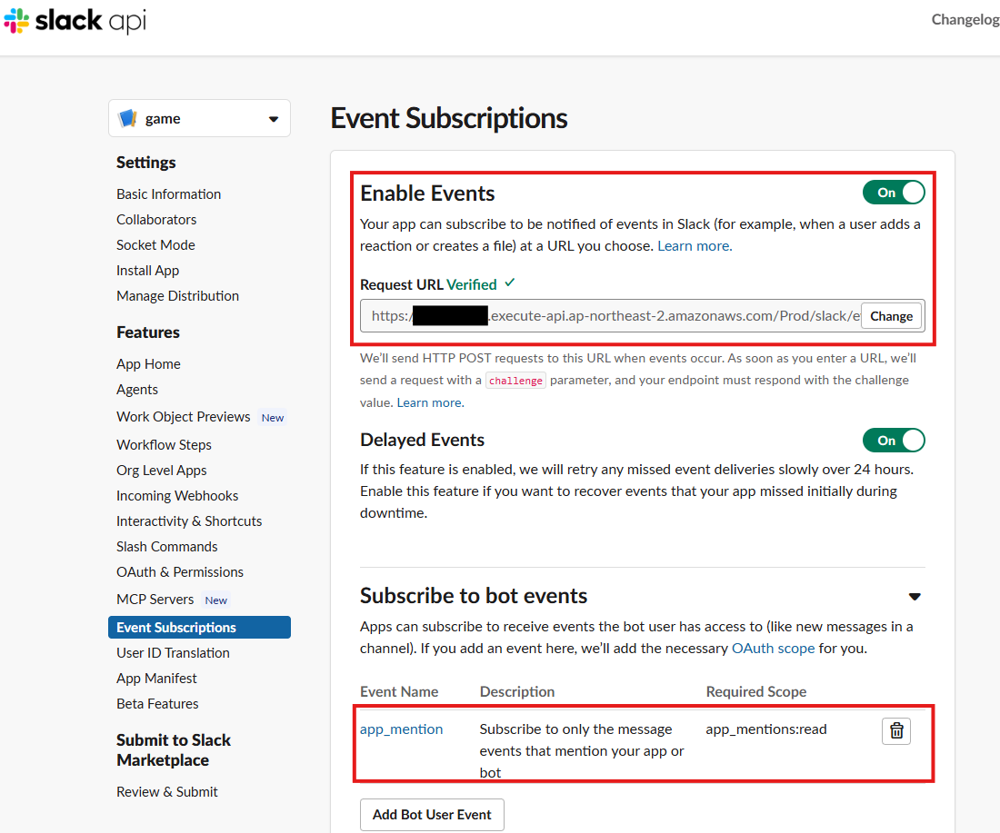

# Lambda Slack App - Bolt for Python

## Basic Information

Terraform Variables
- `slack_client_id`
- `slack_client_secret`
- `slack_signing_secret`

```hcl
# slack.tfvars
slack_client_id      = "1234567890.1234567890"
slack_client_secret  = "abcdef0123456789abcdef0123456789"
slack_signing_secret = "0123456789abcdef0123456789abcdef"
```

```bash
terraform apply -auto-approve -var-file=slack.tfvars
terraform destroy -auto-approve -var-file=slack.tfvars
```



## Socket Mode : Disabled

본 테라폼 구성의 Lambda 함수(Bolt for Python -> app.py -> lambda_handler
)는 HTTP Events API 방식이므로 Socket Mode 활성화 시 Slack 앱에서 발생한 이벤트가 API Gateway로 전달되지 않습니다.



## OAuth & Permissions

Redirect URLs에 `https://xxxxxx.execute-api.xxxxxx.amazonaws.com/Prod/slack/oauth_redirect` 추가 후 Save URLs 선택

봇 토큰 범위에 적절한 권한 추가
| Project | Bot Token Scopes |
| - | - |
| bedrock-chat | `chat:write`, `app_mentions:read` |
| bedrock-drawing | `chat:write`, `app_mentions:read` |
| bedrock-translate-drawing | `chat:write`, `app_mentions:read` |
| dksh-lunch | `chat:write`, `app_mentions:read` |
| flag-quiz | `chat:write`, `app_mentions:read` |
| mimic | `chat:write`, `app_mentions:read` |
| rock-scissors-paper | `chat:write`, `app_mentions:read` |
| word-puzzle | `chat:write`, `app_mentions:read` |

세 Bedrock 변형은 위 두 범위만 요청하고, `app_mention`을 즉시 확인한 뒤 Lambda lazy handler에서 처리합니다. 범위와 listener 변경을 반영하려면 Terraform 변경 후 각 Slack 앱을 워크스페이스에 다시 설치합니다.



## Event Subscriptions

Enable Events 활성화 후 `https://xxxxxx.execute-api.xxxxxx.amazonaws.com/Prod/slack/events` 추가

Subscribe to bot events에 `app_mention` 이벤트 추가


